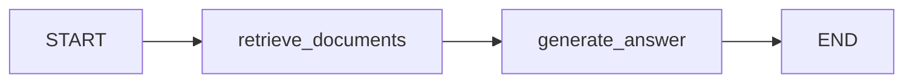

# 5. LangGraph RAG Workflow

## What

The same RAG pipeline, expressed as a graph in `rag_lab/langgraph_rag/`:



| File | Role |
|---|---|
| `state.py` | `RAGState` TypedDict: `question`, `documents`, `answer` |
| `nodes/retrieve_documents.py` | reads `question`, writes `documents` |
| `nodes/generate_answer.py` | reads `question` + `documents`, writes `answer` |
| `graph.py` | registers nodes and edges, compiles the graph |

## Why

A chain is a fixed pipe. A graph makes each step an explicit **node** with a shared **state**.
For a two-step pipeline that is more code – but it is the foundation for loops and decisions
(next chapter), which a linear chain cannot express cleanly.

## How state moves between nodes

A node is a plain function `node(state) -> dict`. It returns only the keys it changes;
LangGraph merges the update into the state before the next node runs.

```
invoke({"question": "Q"})
  retrieve_documents -> {"documents": [...]}   state = {question, documents}
  generate_answer    -> {"answer": "..."}      state = {question, documents, answer}
```

Dependencies (retriever, LLM) are bound with `functools.partial`, so nodes stay plain functions
that unit tests can call directly:

```python
graph = StateGraph(RAGState)
graph.add_node("retrieve_documents", partial(retrieve_documents, retriever=retriever))
graph.add_node("generate_answer", partial(generate_answer, llm=llm))
graph.add_edge(START, "retrieve_documents")
graph.add_edge("retrieve_documents", "generate_answer")
graph.add_edge("generate_answer", END)
app = graph.compile()
```

## Run

```bash
uv run python -m examples.basic_langgraph_rag
```

## Expected output

The example prints the graph as Mermaid text, then every state update:

```
Question: How many vacation days do I get, and how many can I carry over?

-> node 'retrieve_documents' updated state keys: ['documents']
-> node 'generate_answer' updated state keys: ['answer']

Answer: ... 27 paid vacation days ... up to 5 days ...
```

The answer matches the LangChain example – same retriever, same prompt, different orchestration.
