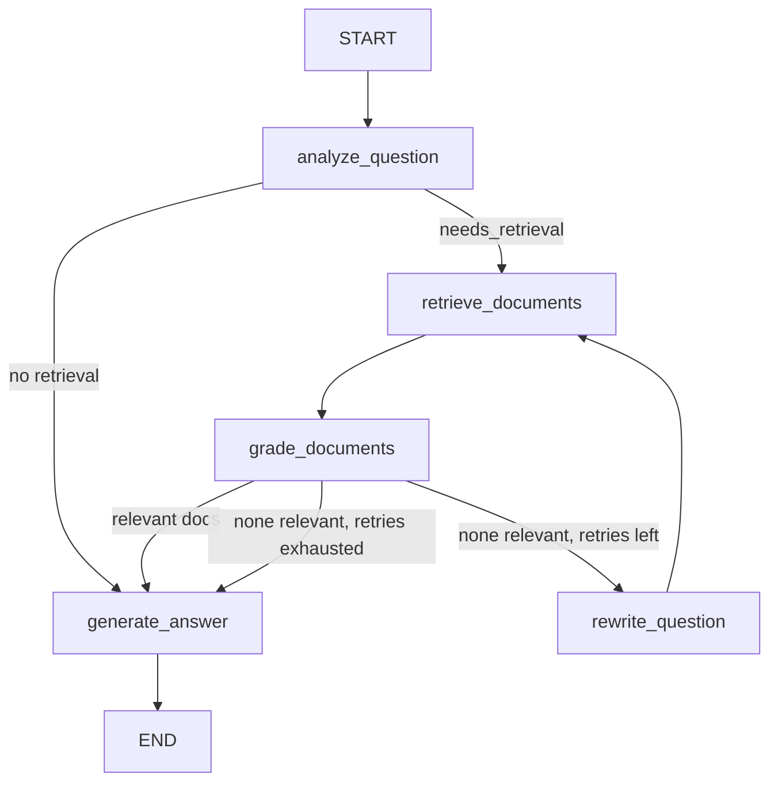

# 6. Agentic RAG with LangGraph

## What

A graph that **decides** instead of always running the same steps (`rag_lab/agentic_rag/`):



## Nodes – and who decides

| Node | Decided by | Reads → Writes |
|---|---|---|
| `analyze_question` | **LLM** (structured output `RetrievalDecision`) | question → needs_retrieval, search_query, retry_count=0 |
| `retrieve_documents` | deterministic | search_query → documents |
| `grade_documents` | **LLM**, one yes/no per chunk (`RelevanceGrade`) | question, documents → relevant_documents |
| `rewrite_question` | **LLM** generates a new query | question, search_query → search_query, retry_count+1 |
| `generate_answer` | **LLM**, except the fallback (Python rule) | → answer |

## Conditional edges – pure Python (`routing.py`)

```python
def route_after_analysis(state):
    return "retrieve_documents" if state["needs_retrieval"] else "generate_answer"

def route_after_grading(state):
    if state["relevant_documents"]:
        return "generate_answer"
    if state["retry_count"] >= state.get("max_retries", 2):
        return "generate_answer"          # give up -> fallback answer
    return "rewrite_question"
```

The LLM makes *judgements* (stored in the state); plain Python reads them and picks the path.
This keeps control flow predictable and testable, and **guarantees termination**: every
rewrite increments `retry_count`, and the router stops at `max_retries`.

## Fallback – no invented answers

If retrieval was needed but no chunk was graded relevant, `generate_answer` returns a fixed
message **without calling the LLM**, so the model has no chance to make something up.

## Run

```bash
uv run python -m examples.agentic_rag
uv run python -m examples.agentic_rag "How much does the Glowbeam Studio edition cost?"
```

## Expected output (three demo questions)

```
Question: What do I do when TunnelKite shows error TK-407?
  -> analyze_question     needs_retrieval=True
  -> retrieve_documents   retrieved 4 chunks
  -> grade_documents      1 chunks graded relevant
  -> generate_answer
Answer: Your device certificate has expired; run "Renew Device Certificate" in AppDock.

Question: What is 12 times 7?
  -> analyze_question     needs_retrieval=False
  -> generate_answer
Answer: 84

Question: What is Lumora's policy on bringing dogs to the office?
  -> analyze_question     needs_retrieval=True
  -> retrieve_documents   retrieved 4 chunks
  -> grade_documents      0 chunks graded relevant
  -> rewrite_question     retry 1: new query 'Lumora office pet dog policy'
  ... (retry 2) ...
  -> generate_answer
Answer: I couldn't find information about this in the Lumora Systems knowledge base, ...
```

LLM decisions can vary between runs – that is the nature of agentic workflows.

## Cost

Per question: 1 analysis call + up to `k` grading calls per retrieval + rewrites + 1 answer.
With `k=4` and `max_retries=2` the worst case is 1 + 3·4 + 2 + 0 = 15 LLM calls.
