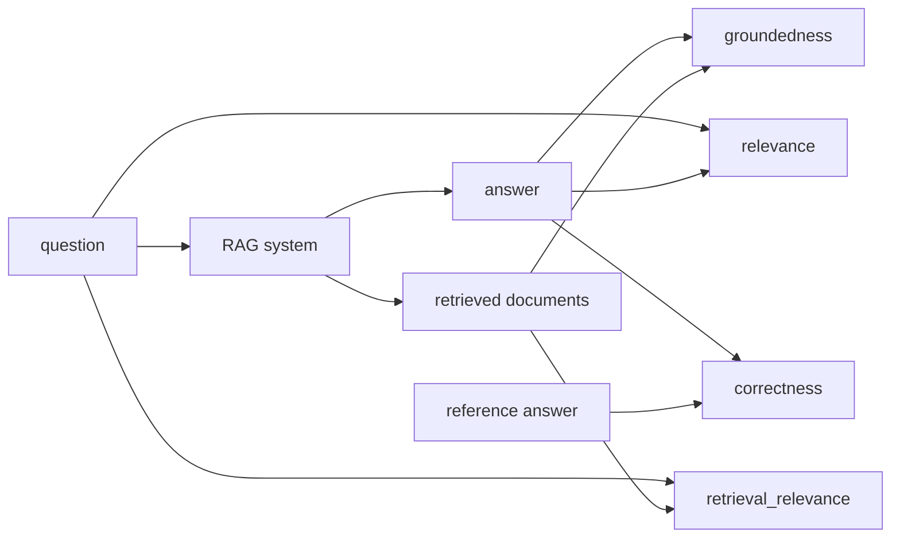

# 12. LLM-as-a-Judge: Evaluating RAG Answers

## What

A second LLM - the **judge** - grades the answers of the RAG system. `rag_lab/evaluation/` contains four
judges, each checking **one** quality aspect with a yes/no verdict and its reasoning:

| Judge | Question it answers | Looks at | Needs a reference answer |
|---|---|---|---|
| `correctness` | Is the answer factually right? | question, answer, reference answer | **yes** |
| `relevance` | Does the answer address the question? | question, answer | no |
| `groundedness` | Is every claim backed by the retrieved documents (no hallucination)? | answer, documents | no |
| `retrieval_relevance` | Did the retriever find related documents? | question, documents | no |



## Why

Unit tests prove the *plumbing* works, but not whether answers are *good*. Exact string comparison fails
for free text ("27 days" vs. "You get twenty-seven days"). A judge LLM can compare meaning - and the four
aspects tell you **where** a problem is: bad retrieval (`retrieval_relevance`), invented facts
(`groundedness`), off-topic answers (`relevance`) or simply wrong answers (`correctness`).

## Best practices used here

Following the LangSmith tutorial [Evaluate a RAG application](https://docs.langchain.com/langsmith/evaluate-rag-tutorial):

- **One judge per aspect** with a clear criterion, instead of one "rate the answer" prompt.
- **Binary verdicts** (`True`/`False`) instead of 1-10 scales - easier to agree on and to aggregate.
- **Reasoning before the verdict**: the output schema lists `explanation` *before* the verdict field, so
  the model reasons first and decides afterwards.
- **Structured output** (`with_structured_output(..., method="json_schema", strict=True)`): the verdict is
  a real `bool`, never text that must be parsed.
- **Temperature 0** for repeatable grading (`get_judge_model()`; reasoning models such as gpt-5 accept
  only their default temperature - langchain-openai then drops the value).
- **Documents are data**: the prompts tell the judge to ignore instructions inside the documents.
- **Calibrate the judge** before trusting it: `examples.calibrate_judges` runs it on hand-labelled cases.
- **A separate judge model** can be set with `JUDGE_MODEL` in `.env` (default: `LLM_MODEL`).

## The code

The schema decides the order of the output - explanation first:

```python
class GroundednessGrade(BaseModel):
    explanation: str = Field(description="Explain your reasoning step by step before giving the verdict")
    grounded: bool = Field(description="True if every claim of the answer is supported by the FACTS")
```

One judge call:

```python
def judge_groundedness(llm, answer, documents) -> JudgeResult:
    if not documents:
        return JudgeResult("groundedness", None, "No documents were used for this answer.")
    grader = llm.with_structured_output(GroundednessGrade, method="json_schema", strict=True)
    grade = grader.invoke(GROUNDEDNESS_PROMPT.invoke({"facts": format_docs(documents), "answer": answer}))
    return JudgeResult("groundedness", grade.grounded, grade.explanation)
```

`passed=None` means *not applicable* - e.g. the agentic graph answered "12 times 7" without documents.
Such verdicts are not counted in the pass rate.

| File | Role |
|---|---|
| `evaluation/dataset.py` | 9 questions with human-written reference answers (one deliberately not in the documents), plus calibration cases |
| `evaluation/prompts.py` | the four judge prompts and output schemas |
| `evaluation/judges.py` | one function per judge, `run_judge()` (one judge by name), `run_all_judges()` |
| `evaluation/targets.py` | adapters: chain, graph and agentic graph → `question -> {"answer", "documents"}` |
| `evaluation/runner.py` | runs a target over the dataset, `pass_rates()` |

## How it connects

The judges grade the three implementations from chapters 5-7 on the same questions, so their quality can
be compared directly. For the agentic graph, `documents` are only the chunks it graded relevant - exactly
what its answer was generated from.

## Run

Needs a real `LLM_API_KEY` and data ingested **with real embeddings** (chapter 2).

```bash
uv run python -m examples.calibrate_judges                  # 8 judge calls, no database
uv run python -m examples.evaluate_rag agentic --limit 3    # cheap first run
uv run python -m examples.evaluate_rag                      # all targets, all questions
```

Cost: per question and target one RAG run plus up to four judge calls - for everything
27 RAG runs and up to 108 judge calls.

## Expected output (shape - the verdicts depend on the models)

```
Judge model: gpt-5-mini

agree     correctness          expected=True  judge=True  Full-time employees get 27 paid vacation days a year.
agree     correctness          expected=False judge=False Full-time employees get 30 paid vacation days a year.
...
Agreement with the human labels: 8/8
```

```
=== agentic  (9 questions, 95 s incl. judging)
  question                                                    correctness    relevance groundedness retrieval_re
  How many paid vacation days do full-time employees get pe          pass         pass         pass         pass
  ...
  What is Lumora's policy on bringing dogs to the office?            pass         FAIL          n/a          n/a
  pass rate                                                           9/9          8/9          8/8          8/8
  Failed judgments (judge reasoning):
   - [relevance] What is Lumora's policy on bringing dogs to the
     answer:  "I couldn't find information about this in the Lumora Systems knowledge base, ..."
     reason:  The answer does not provide the requested policy ...
```

**Read the judges together.** In the last row the agent correctly refuses (correctness *pass*), and the
relevance judge marks the refusal as unhelpful. That is not a bug in the agent - it shows that each judge
sees only its own aspect. Always read the reasoning of failed verdicts before acting on a score.

## Limits

- A judge is an LLM: it can be wrong, and verdicts can vary between runs. Calibrate it, read its reasoning,
  and treat small differences (8/9 vs. 9/9) as noise.
- 9 questions are a smoke test, not a benchmark. Add questions whenever you find a bad answer.
- Correctness depends entirely on the reference answers - keep them short and checked against `data/`.
- For tracking results over time, LangSmith (`client.evaluate`) or the `openevals` library offer the
  same judges with experiment history; this chapter keeps everything local and visible in the code.
