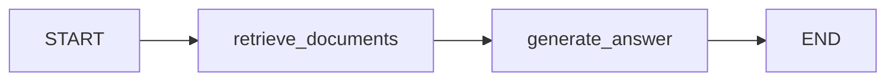

# 5. LangGraph-RAG-Workflow

## Was

Dieselbe RAG-Pipeline, als Graph in `rag_lab/langgraph_rag/`:



| Datei | Aufgabe |
|---|---|
| `state.py` | `RAGState` TypedDict: `question`, `documents`, `answer` |
| `nodes/retrieve_documents.py` | liest `question`, schreibt `documents` |
| `nodes/generate_answer.py` | liest `question` + `documents`, schreibt `answer` |
| `graph.py` | registriert Nodes und Edges, kompiliert den Graphen |

## Warum

Eine Chain ist ein festes Rohr. Ein Graph macht jeden Schritt zu einem expliziten **Node** mit einem gemeinsamen
**State**. Für eine Pipeline mit zwei Schritten ist das mehr Code – aber es ist die Grundlage für Schleifen und
Entscheidungen (nächstes Kapitel), die eine lineare Chain nicht sauber abbilden kann.

## Wie der State zwischen den Nodes wandert

Ein Node ist eine normale Funktion `node(state) -> dict`. Er gibt nur die Schlüssel zurück, die er ändert;
LangGraph führt dieses Update in den State ein, bevor der nächste Node läuft.

```
invoke({"question": "Q"})
  retrieve_documents -> {"documents": [...]}   state = {question, documents}
  generate_answer    -> {"answer": "..."}      state = {question, documents, answer}
```

Abhängigkeiten (Retriever, LLM) werden mit `functools.partial` gebunden. So bleiben die Nodes normale Funktionen,
die Unit-Tests direkt aufrufen können:

```python
graph = StateGraph(RAGState)
graph.add_node("retrieve_documents", partial(retrieve_documents, retriever=retriever))
graph.add_node("generate_answer", partial(generate_answer, llm=llm))
graph.add_edge(START, "retrieve_documents")
graph.add_edge("retrieve_documents", "generate_answer")
graph.add_edge("generate_answer", END)
app = graph.compile()
```

## Ausführen

```bash
uv run python -m examples.basic_langgraph_rag
```

## Erwartete Ausgabe

Das Beispiel gibt den Graphen als Mermaid-Text aus und danach jedes State-Update:

```
Question: How many vacation days do I get, and how many can I carry over?

-> node 'retrieve_documents' updated state keys: ['documents']
-> node 'generate_answer' updated state keys: ['answer']

Answer: ... 27 paid vacation days ... up to 5 days ...
```

Die Antwort entspricht der aus dem LangChain-Beispiel – gleicher Retriever, gleicher Prompt, nur die Ablaufsteuerung ist anders.
