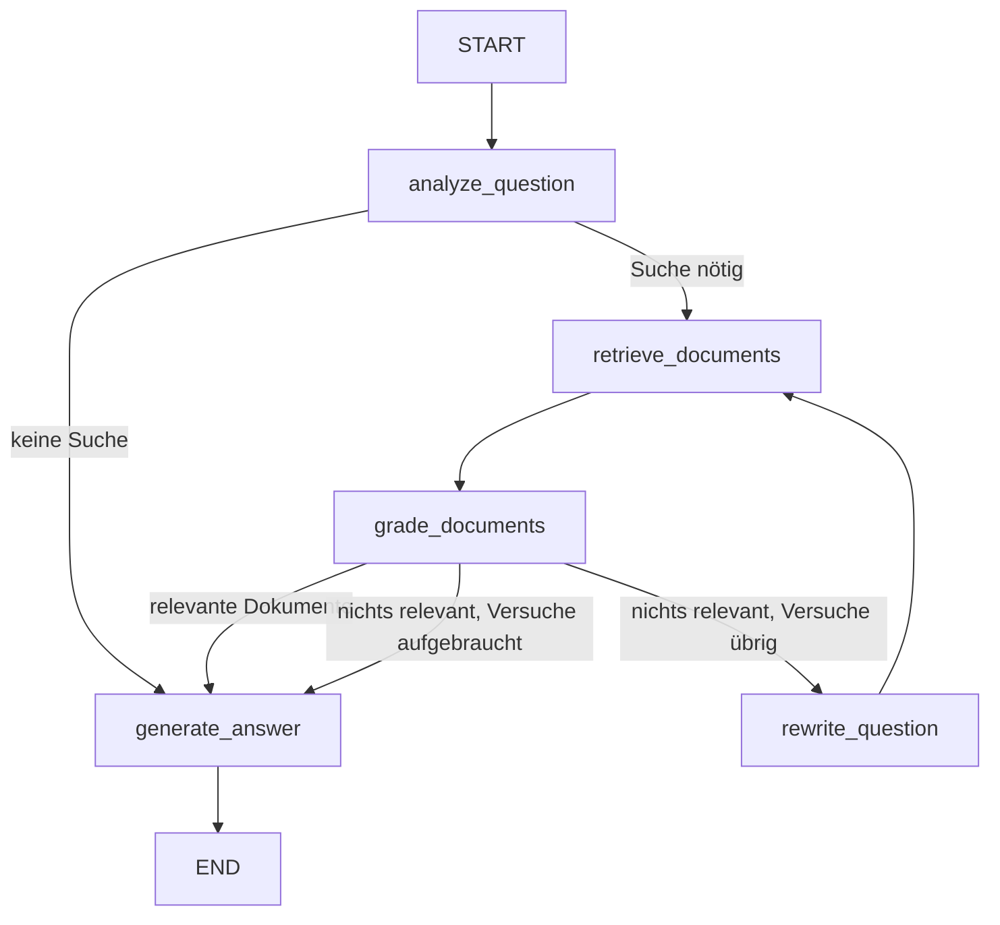

# 6. Agentic RAG mit LangGraph

## Was

Ein Graph, der **entscheidet**, statt immer dieselben Schritte auszuführen (`rag_lab/agentic_rag/`):



## Nodes – und wer entscheidet

| Node | Entschieden von | Liest → Schreibt |
|---|---|---|
| `analyze_question` | **LLM** (strukturierte Ausgabe `RetrievalDecision`) | question → needs_retrieval, search_query, retry_count=0 |
| `retrieve_documents` | deterministisch | search_query → documents |
| `grade_documents` | **LLM**, ein Ja/Nein pro Chunk (`RelevanceGrade`) | question, documents → relevant_documents |
| `rewrite_question` | **LLM** formuliert eine neue Suchanfrage | question, search_query → search_query, retry_count+1 |
| `generate_answer` | **LLM**, außer beim Fallback (Python-Regel) | → answer |

## Bedingte Kanten (Conditional Edges) – reines Python (`routing.py`)

```python
def route_after_analysis(state):
    return "retrieve_documents" if state["needs_retrieval"] else "generate_answer"

def route_after_grading(state):
    if state["relevant_documents"]:
        return "generate_answer"
    if state["retry_count"] >= state.get("max_retries", 2):
        return "generate_answer"          # give up -> fallback answer
    return "rewrite_question"
```

Das LLM trifft *Einschätzungen* (die im State gespeichert werden); normales Python liest sie und wählt den Weg.
Das hält den Ablauf vorhersehbar und testbar und **garantiert, dass der Graph endet**: Jede Umformulierung erhöht
`retry_count`, und der Router hört bei `max_retries` auf.

## Fallback – keine erfundenen Antworten

Wenn eine Suche nötig war, aber kein Chunk als relevant bewertet wurde, gibt `generate_answer` eine feste Nachricht
zurück, **ohne das LLM aufzurufen** – das Modell bekommt also keine Gelegenheit, etwas zu erfinden.

## Ausführen

```bash
uv run python -m examples.agentic_rag
uv run python -m examples.agentic_rag "How much does the Glowbeam Studio edition cost?"
```

## Erwartete Ausgabe (drei Beispielfragen)

```
Question: What do I do when TunnelKite shows error TK-407?
  -> analyze_question     needs_retrieval=True
  -> retrieve_documents   retrieved 4 chunks
  -> grade_documents      1 chunks graded relevant
  -> generate_answer
Answer: Your device certificate has expired; run "Renew Device Certificate" in AppDock.

Question: What is 12 times 7?
  -> analyze_question     needs_retrieval=False
  -> generate_answer
Answer: 84

Question: What is Lumora's policy on bringing dogs to the office?
  -> analyze_question     needs_retrieval=True
  -> retrieve_documents   retrieved 4 chunks
  -> grade_documents      0 chunks graded relevant
  -> rewrite_question     retry 1: new query 'Lumora office pet dog policy'
  ... (retry 2) ...
  -> generate_answer
Answer: I couldn't find information about this in the Lumora Systems knowledge base, ...
```

Die Entscheidungen des LLM können von Lauf zu Lauf abweichen – das liegt in der Natur agentischer Workflows.

## Kosten

Pro Frage: 1 Analyse-Aufruf + bis zu `k` Bewertungs-Aufrufe pro Suche + Umformulierungen + 1 Antwort.
Mit `k=4` und `max_retries=2` sind es im schlimmsten Fall 1 + 3·4 + 2 + 0 = 15 LLM-Aufrufe.
