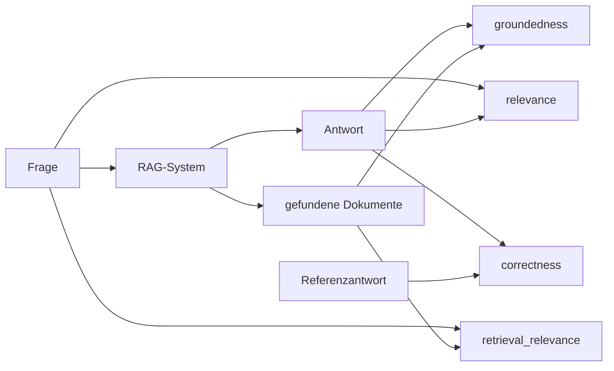

# 10. LLM-as-a-Judge: RAG-Antworten bewerten

## Was

Ein zweites LLM – der **Judge** (Richter) – bewertet die Antworten des RAG-Systems. `rag_lab/evaluation/` enthält vier
Judges; jeder prüft **einen** Qualitätsaspekt mit einem Ja/Nein-Urteil samt Begründung:

| Judge | Frage, die er beantwortet | Sieht | Braucht Referenzantwort |
|---|---|---|---|
| `correctness` | Ist die Antwort inhaltlich richtig? | Frage, Antwort, Referenzantwort | **ja** |
| `relevance` | Geht die Antwort auf die Frage ein? | Frage, Antwort | nein |
| `groundedness` | Ist jede Aussage durch die gefundenen Dokumente belegt (keine Halluzination)? | Antwort, Dokumente | nein |
| `retrieval_relevance` | Hat der Retriever passende Dokumente gefunden? | Frage, Dokumente | nein |



## Warum

Unit-Tests beweisen, dass die *Verdrahtung* funktioniert, aber nicht, ob die Antworten *gut* sind. Ein exakter
Textvergleich scheitert bei freiem Text („27 days" vs. „You get twenty-seven days"). Ein Judge-LLM kann die Bedeutung
vergleichen – und die vier Aspekte zeigen, **wo** ein Problem liegt: schlechte Suche (`retrieval_relevance`), erfundene
Fakten (`groundedness`), Antworten am Thema vorbei (`relevance`) oder schlicht falsche Antworten (`correctness`).

## Umgesetzte Best Practices

Nach dem LangSmith-Tutorial [Evaluate a RAG application](https://docs.langchain.com/langsmith/evaluate-rag-tutorial):

- **Ein Judge pro Aspekt** mit klarem Kriterium statt eines einzigen „bewerte die Antwort"-Prompts.
- **Binäre Urteile** (`True`/`False`) statt Skalen von 1–10 – leichter übereinstimmend zu vergeben und zusammenzufassen.
- **Begründung vor dem Urteil**: Das Ausgabeschema führt `explanation` *vor* dem Urteilsfeld, das Modell denkt also
  zuerst nach und entscheidet danach.
- **Strukturierte Ausgabe** (`with_structured_output(..., method="json_schema", strict=True)`): Das Urteil ist ein
  echtes `bool`, nie Text, der erst ausgewertet werden muss.
- **Temperatur 0** für wiederholbare Bewertungen (`get_judge_model()`; Reasoning-Modelle wie gpt-5 akzeptieren nur
  ihre Standardtemperatur – langchain-openai lässt den Wert dann weg).
- **Dokumente sind Daten**: Die Prompts weisen den Judge an, Anweisungen in den Dokumenten zu ignorieren.
- **Den Judge kalibrieren**, bevor man ihm vertraut: `examples.calibrate_judges` prüft ihn an von Hand bewerteten Fällen.
- **Ein eigenes Judge-Modell** lässt sich mit `JUDGE_MODEL` in `.env` setzen (Standard: `LLM_MODEL`).

## Der Code

Das Schema bestimmt die Reihenfolge der Ausgabe – Begründung zuerst:

```python
class GroundednessGrade(BaseModel):
    explanation: str = Field(description="Explain your reasoning step by step before giving the verdict")
    grounded: bool = Field(description="True if every claim of the answer is supported by the FACTS")
```

Ein Judge-Aufruf:

```python
def judge_groundedness(llm, answer, documents) -> JudgeResult:
    if not documents:
        return JudgeResult("groundedness", None, "No documents were used for this answer.")
    grader = llm.with_structured_output(GroundednessGrade, method="json_schema", strict=True)
    grade = grader.invoke(GROUNDEDNESS_PROMPT.invoke({"facts": format_docs(documents), "answer": answer}))
    return JudgeResult("groundedness", grade.grounded, grade.explanation)
```

`passed=None` bedeutet *nicht anwendbar* – z. B. wenn der agentische Graph „12 mal 7" ohne Dokumente beantwortet hat.
Solche Urteile zählen nicht zur Bestehensquote.

| Datei | Aufgabe |
|---|---|
| `evaluation/dataset.py` | 9 Fragen mit von Menschen geschriebenen Referenzantworten (eine bewusst nicht in den Dokumenten), dazu Kalibrierungsfälle |
| `evaluation/prompts.py` | die vier Judge-Prompts und Ausgabeschemas |
| `evaluation/judges.py` | eine Funktion pro Judge, `run_all_judges()` |
| `evaluation/targets.py` | Adapter: Chain, Graph und agentischer Graph → `question -> {"answer", "documents"}` |
| `evaluation/runner.py` | führt ein Ziel über den Datensatz aus, `pass_rates()` |

## Wie es zusammenhängt

Die Judges bewerten die drei Umsetzungen aus Kapitel 4–6 mit denselben Fragen, deren Qualität lässt sich also direkt
vergleichen. Beim agentischen Graphen sind `documents` nur die Chunks, die er als relevant bewertet hat – genau das,
woraus seine Antwort entstand.

## Ausführen

Braucht einen echten `LLM_API_KEY` und Daten, die **mit echten Embeddings** eingelesen wurden (Kapitel 2).

```bash
uv run python -m examples.calibrate_judges                  # 8 judge calls, no database
uv run python -m examples.evaluate_rag agentic --limit 3    # cheap first run
uv run python -m examples.evaluate_rag                      # all targets, all questions
```

Kosten: pro Frage und Ziel ein RAG-Durchlauf plus bis zu vier Judge-Aufrufe – für alles zusammen
27 RAG-Durchläufe und bis zu 108 Judge-Aufrufe.

## Erwartete Ausgabe (Form – die Urteile hängen von den Modellen ab)

```
Judge model: gpt-5-mini

agree     correctness          expected=True  judge=True  Full-time employees get 27 paid vacation days a year.
agree     correctness          expected=False judge=False Full-time employees get 30 paid vacation days a year.
...
Agreement with the human labels: 8/8
```

```
=== agentic  (9 questions, 95 s incl. judging)
  question                                                    correctness    relevance groundedness retrieval_re
  How many paid vacation days do full-time employees get pe          pass         pass         pass         pass
  ...
  What is Lumora's policy on bringing dogs to the office?            pass         FAIL          n/a          n/a
  pass rate                                                           9/9          8/9          8/8          8/8
  Failed judgments (judge reasoning):
   - [relevance] What is Lumora's policy on bringing dogs to the
     answer:  "I couldn't find information about this in the Lumora Systems knowledge base, ..."
     reason:  The answer does not provide the requested policy ...
```

**Die Judges zusammen lesen.** In der letzten Zeile lehnt der Agent korrekt ab (correctness *pass*), und der
Relevance-Judge wertet die Ablehnung als nicht hilfreich. Das ist kein Fehler des Agenten – es zeigt, dass jeder Judge
nur seinen eigenen Aspekt sieht. Vor jeder Reaktion auf einen Score immer die Begründung der fehlgeschlagenen Urteile lesen.

## Grenzen

- Ein Judge ist ein LLM: Er kann irren, und Urteile können zwischen Läufen schwanken. Ihn kalibrieren, seine Begründung
  lesen und kleine Unterschiede (8/9 vs. 9/9) als Rauschen betrachten.
- 9 Fragen sind ein Schnelltest, kein Benchmark. Bei jeder schlechten Antwort, die du findest, eine Frage hinzufügen.
- Correctness hängt vollständig von den Referenzantworten ab – sie kurz halten und gegen `data/` prüfen.
- Um Ergebnisse über die Zeit zu verfolgen, bieten LangSmith (`client.evaluate`) oder die Bibliothek `openevals`
  dieselben Judges mit Versuchshistorie; dieses Kapitel hält alles lokal und im Code sichtbar.
